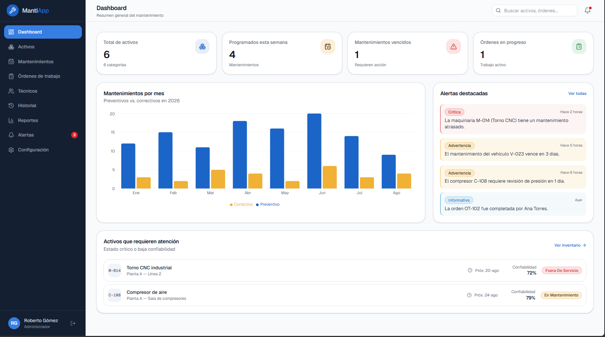
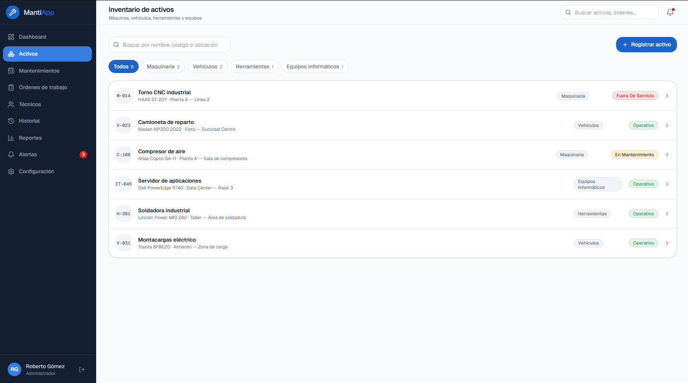
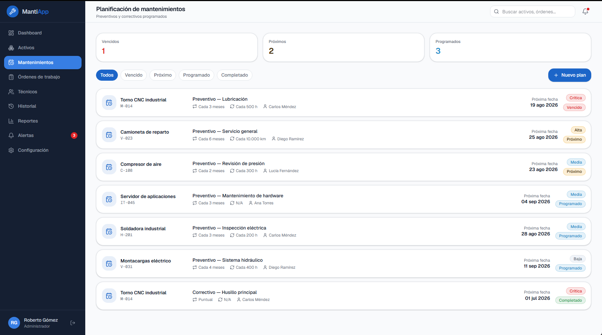
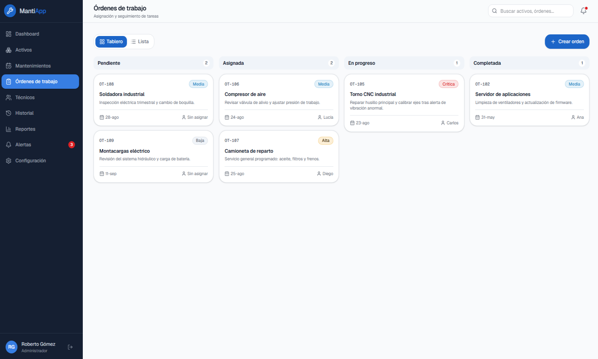
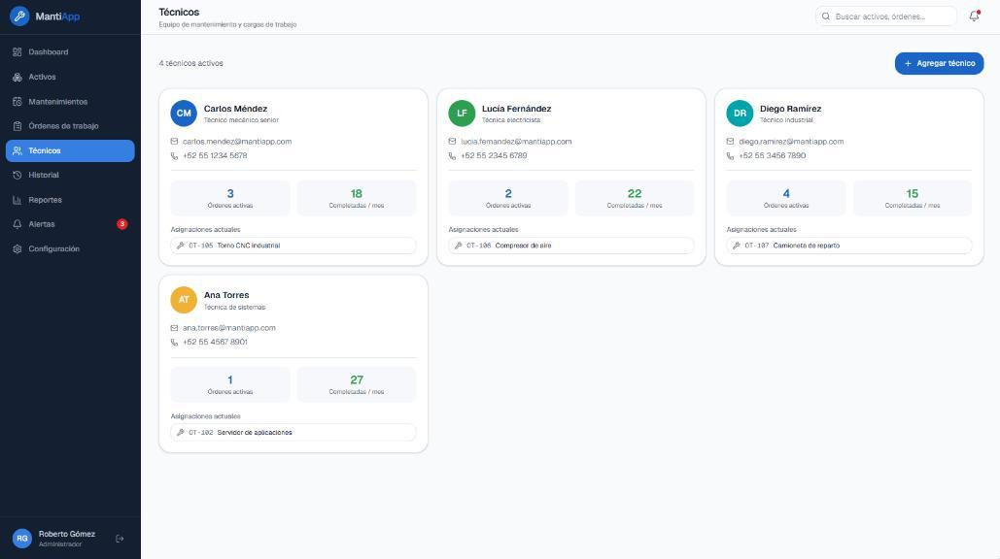
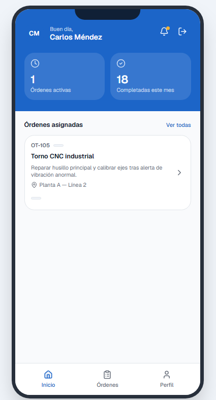
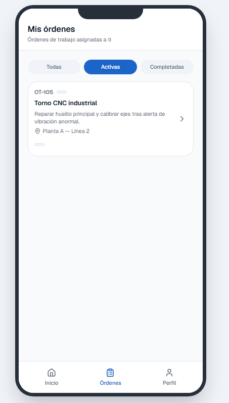
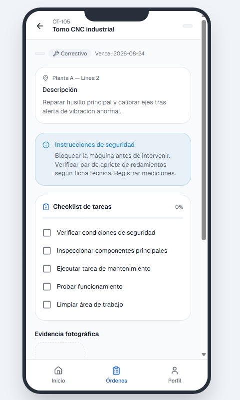
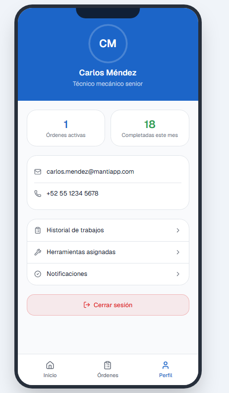

# MantiApp

**Gestión de activos y mantenimiento para pequeñas y medianas empresas.**

MantiApp centraliza el inventario, la planificación de mantenimientos y el seguimiento de órdenes de trabajo. Su objetivo es facilitar la transición del mantenimiento reactivo a una operación preventiva y organizada, conectando a administradores y técnicos mediante una plataforma web y una aplicación móvil.

Proyecto académico del **Equipo T-025 / CachadaSV**, desarrollado para la asignatura **Diseño y Programación de Software Multiplataforma DPS941 GOIT (Virtual)** de la **Universidad Don Bosco**.

[Repositorio oficial](https://github.com/FloppaCoder/MantiApp) · [Aplicación web](https://manti-app.vercel.app/) · [Pull requests](https://github.com/FloppaCoder/MantiApp/pulls?q=is%3Apr) · [Historial de commits](https://github.com/FloppaCoder/MantiApp/commits)

## Entregables académicos

Los enlaces siguientes se conservan de la documentación del proyecto. Los recursos de SharePoint pueden requerir acceso institucional.

### Etapa 4

-   **Video Demostrativo:** [Ver grabación en SharePoint](https://udbedu-my.sharepoint.com/:v:/g/personal/cg232706_alumno_udb_edu_sv/IQDuM643CYzdR7cQu0_rKxPBAbiS7aFcqmCo4-X1noBQAUw?e=b6OHPf&nav=eyJyZWZlcnJhbEluZm8iOnsicmVmZXJyYWxBcHAiOiJTdHJlYW1XZWJBcHAiLCJyZWZlcnJhbFZpZXciOiJTaGFyZURpYWxvZy1MaW5rIiwicmVmZXJyYWxBcHBQbGF0Zm9ybSI6IldlYiIsInJlZmVycmFsTW9kZSI6InZpZXcifX0%3D)
-   **Documento de Investigación:** [Leer PDF en SharePoint](https://udbedu-my.sharepoint.com/:b:/g/personal/cg232706_alumno_udb_edu_sv/IQDPGdcalrwsRJUqWj2hvGjhAYmGXlSRoiI-8sc0_f7p1Uc?e=AfIesB)

### Etapa 3

-   **Video Demostrativo:** [Ver grabación en SharePoint](https://udbedu-my.sharepoint.com/:v:/g/personal/cg232706_alumno_udb_edu_sv/IQB-M4b6HTq1Sa5FPDPMx-MPAcdaPFZRTQ8JLXrIwUxb0xk?e=fQ9tww&nav=eyJyZWZlcnJhbEluZm8iOnsicmVmZXJyYWxBcHAiOiJTdHJlYW1XZWJBcHAiLCJyZWZlcnJhbFZpZXciOiJTaGFyZURpYWxvZy1MaW5rIiwicmVmZXJyYWxBcHBQbGF0Zm9ybSI6IldlYiIsInJlZmVycmFsTW9kZSI6InZpZXcifX0%3D)
-   **Documento de Investigación:** [Leer PDF en SharePoint](https://udbedu-my.sharepoint.com/:b:/g/personal/cg232706_alumno_udb_edu_sv/IQCRMv8bch5NRadI-rkERXAlAQMFudU5FD_pECQeBtNeGGk?e=Z3Wveo)

## Contenido

- [Entregables académicos](#entregables-académicos)
- [Funcionalidades](#funcionalidades)
- [Mockups de Figma](#mockups-de-figma)
- [Tecnologías y arquitectura](#tecnologías-y-arquitectura)
- [Estructura del repositorio](#estructura-del-repositorio)
- [Instalación y configuración](#instalación-y-configuración)
- [Verificación del proyecto](#verificación-del-proyecto)
- [Equipo y evidencia de colaboración](#equipo-y-evidencia-de-colaboración)
- [Convención de commits y contribuciones](#convención-de-commits-y-contribuciones)
- [Licencia](#licencia)

## Funcionalidades

| Plataforma | Usuario | Funcionalidades |
| --- | --- | --- |
| Panel web | Administrador | Consulta de métricas, gestión de activos, planificación de mantenimientos, asignación y seguimiento de órdenes, consulta de técnicos y evidencias. |
| Aplicación móvil | Técnico | Consulta de órdenes asignadas, actualización de estados, checklist de tareas, registro de observaciones y carga de evidencia fotográfica. |
| Acceso | Ambos roles | Registro e inicio de sesión mediante Supabase Auth, acceso con Google y perfiles diferenciados. |

El flujo de trabajo contempla órdenes **pendientes, asignadas, en progreso y completadas**. Las fotografías se almacenan en Supabase Storage y sus direcciones se guardan junto con las observaciones de la orden.

## Mockups de Figma

Prototipos visuales del panel administrativo y de la aplicación móvil para técnicos, extraídos del documento de mockups del proyecto. Representan el diseño propuesto de las interfaces.

[Consultar el documento completo de mockups (PDF, 9 páginas)](docs/mockups/mantiapp-mockups.pdf)

### Panel administrativo web

**Panel de control (Dashboard)**



**Inventario de activos**



**Planificación de mantenimientos**



**Órdenes de trabajo**



**Equipo de técnicos**



### Aplicación móvil para técnicos

| Inicio | Órdenes asignadas |
| --- | --- |
|  |  |

| Detalle de orden y checklist | Perfil del técnico |
| --- | --- |
|  |  |

## Tecnologías y arquitectura

| Componente | Tecnologías |
| --- | --- |
| Panel web y API | Next.js 16, React 19, TypeScript y App Router |
| Estilos web | Tailwind CSS 4 |
| Aplicación móvil | Expo 58, React Native y TypeScript |
| Datos y autenticación | Supabase: PostgreSQL, Auth y Storage |
| Validación del código | ESLint, TypeScript y pruebas con `node --test` |
| Control de versiones | Git y GitHub |
| Despliegue web | Vercel |

Las versiones concretas y sus dependencias están declaradas en los archivos `package.json` y `package-lock.json` de cada aplicación.

```text
Administrador → Panel web Next.js → API de Next.js → Supabase
Técnico       → App Expo          → /api/movil/*   → Supabase
                    ├─ Autenticación → Supabase Auth
                    └─ Fotografías   → Supabase Storage
```

La API móvil recibe el token de sesión del técnico, verifica su identidad y rol, y limita las operaciones a sus órdenes asignadas. Las políticas de acceso de Supabase complementan estas comprobaciones.

Las entidades principales del modelo son:

- **`profiles`**: información del usuario y su rol, vinculada a Supabase Auth.
- **`assets`**: inventario de activos, categorías, ubicaciones y estados.
- **`maintenance_plans`**: planificación de tareas y fechas de mantenimiento.
- **`work_orders`**: asignaciones, estados, checklist, observaciones y fotografías.

La migración del 22 de noviembre de 2026 documenta la unificación de la antigua tabla `users` en `profiles`.

## Estructura del repositorio

```text
MantiApp/
├── mantiapp-web/
│   ├── app/                 Rutas, panel administrativo y API
│   ├── components/          Componentes de la interfaz web
│   ├── lib/                 Reglas de dominio y acceso a servicios
│   ├── tests/               Pruebas de dominio, componentes y API
│   └── .env.example         Variables de entorno de referencia
├── mantiapp-mobile/
│   ├── App.tsx              Entrada de la aplicación móvil
│   ├── screens/             Pantallas de acceso y operación
│   ├── components/          Interfaz y componentes de órdenes
│   ├── lib/                 Sesión, API, reportes y fotografías
│   ├── assets/              Recursos gráficos
│   └── tests/               Pruebas de integración con la API
├── supabase/
│   ├── migrations/          Cambios documentados del esquema
│   └── seed.sql             Reinicio y carga de datos de demostración
├── scripts/                 Utilidades de respaldo
└── README.md
```

## Instalación y configuración

### Requisitos

- Git y Node.js con npm, en una versión compatible con las dependencias de ambas aplicaciones.
- Un proyecto de Supabase con el esquema, las políticas de acceso y los proveedores de autenticación configurados.
- Para la app móvil, un dispositivo o emulador compatible con la versión de Expo utilizada.

**Configuración del backend:** las migraciones incluidas modifican un esquema previo; no constituyen una instalación completa desde una base vacía. Para reproducir el entorno se necesita el esquema base del equipo, el bucket público `evidencias` con sus políticas de acceso y la configuración de Google y sus URL de redirección si se utiliza ese proveedor.

> `supabase/seed.sql` elimina datos existentes y cuentas que no estén en su lista de conservación. Está destinado a preparar demostraciones sobre una base configurada; revisar el script y realizar un respaldo antes de ejecutarlo.

### 1. Clonar el repositorio

```bash
git clone https://github.com/FloppaCoder/MantiApp.git
cd MantiApp
```

### 2. Iniciar el panel web

```bash
cd mantiapp-web
npm ci
```

Crear `mantiapp-web/.env.local` tomando como referencia `.env.example`:

```dotenv
NEXT_PUBLIC_SUPABASE_URL=https://tu-proyecto.supabase.co
NEXT_PUBLIC_SUPABASE_ANON_KEY=tu-clave-publica-anon
```

```bash
npm run dev
```

Abrir [localhost:3000](http://localhost:3000) e iniciar sesión con un perfil de administrador.

Para permitir el acceso desde un teléfono de la misma red, iniciar la web con:

```bash
npm run dev -- --hostname 0.0.0.0
```

### 3. Iniciar la aplicación móvil

Desde otra terminal, situada en la raíz del repositorio:

```bash
cd mantiapp-mobile
npm ci
```

Crear `mantiapp-mobile/.env.local`:

```dotenv
EXPO_PUBLIC_API_URL=http://192.168.1.100:3000
EXPO_PUBLIC_SUPABASE_URL=https://tu-proyecto.supabase.co
EXPO_PUBLIC_SUPABASE_ANON_KEY=tu-clave-publica-anon
```

Usar el mismo proyecto de Supabase en ambas aplicaciones. Sustituir la IP de ejemplo por la del equipo que ejecuta Next.js; en el emulador de Android Studio puede utilizarse `http://10.0.2.2:3000`. La URL de la API debe indicar el origen, **sin `/api` al final**.

```bash
npm start -- --clear
```

Abrir la aplicación en el dispositivo o emulador e iniciar sesión con un perfil cuyo rol sea `tecnico`. El teléfono debe poder acceder al puerto 3000 del equipo; el túnel de Expo no publica la API de Next.js.

Los archivos `.env.local` no deben subirse al repositorio. Las variables `NEXT_PUBLIC_*` y `EXPO_PUBLIC_*` son públicas: utilizar la clave pública de Supabase, nunca una clave `service_role`.

## Verificación del proyecto

Ejecutar los siguientes comandos dentro de cada aplicación:

| Aplicación | Comando | Propósito |
| --- | --- | --- |
| Web | `npm run lint` | Revisar el código con ESLint |
| Web y móvil | `npm run typecheck` | Comprobar los tipos de TypeScript |
| Web y móvil | `npm test` | Ejecutar las pruebas automatizadas disponibles |
| Web | `npm run build` | Generar la compilación de producción |

Para verificar el flujo completo con datos de prueba:

1. Acceder al panel administrativo y registrar un activo.
2. Crear una orden y asignarla a un técnico.
3. Acceder a la app móvil con ese técnico y comprobar la asignación.
4. Iniciar la orden, completar el checklist y guardar observaciones y fotografías.
5. Consultar el avance y las evidencias desde la web y completar la orden.

Estos pasos requieren el backend configurado y cuentas de prueba para ambos roles.

## Equipo y evidencia de colaboración

**Equipo T-025 / CachadaSV — Universidad Don Bosco**

**Docente:** Alexander Alberto Sigüenza Campos

Los siguientes aportes se sustentan en el historial Git del repositorio. Son ejemplos verificables, no una distribución exclusiva de responsabilidades.

| Integrante | Carnet | Cuenta de GitHub | Aportes registrados | Evidencia |
| --- | --- | --- | --- | --- |
| Carlos Marcelo Cruz Menjívar | CM232707 | [FloppaCoder](https://github.com/FloppaCoder) | Endpoints de la API, autenticación y carga de fotografías desde móvil. | [API de técnicos · 4b01c8e](https://github.com/FloppaCoder/MantiApp/commit/4b01c8e), [evidencia fotográfica · e35cbba](https://github.com/FloppaCoder/MantiApp/commit/e35cbba) |
| Víctor Rafael Cornejo García | CG232706 | [Viiictor01](https://github.com/Viiictor01) | Vistas de acceso y registro, validación de login y documentación. | [Login y registro · 6ae7b76](https://github.com/FloppaCoder/MantiApp/commit/6ae7b76), [documentación · b177ec2](https://github.com/FloppaCoder/MantiApp/commit/b177ec2) |
| Eleazar Hazael Amaya Sánchez | AS232697 | [yAeroo](https://github.com/yAeroo) | Vistas y consumo de endpoints, configuración y pantallas de la aplicación móvil. | [Vistas y endpoints · 68df75b](https://github.com/FloppaCoder/MantiApp/commit/68df75b), [vistas móviles · 689f311](https://github.com/FloppaCoder/MantiApp/commit/689f311) |

### Integración mediante pull requests

El historial también registra la integración de ramas de trabajo mediante pull requests:

| Pull request | Rama integrada | Integración registrada por |
| --- | --- | --- |
| [#1](https://github.com/FloppaCoder/MantiApp/pull/1) | `feat-authrolebased` | MarceLobster |
| [#3](https://github.com/FloppaCoder/MantiApp/pull/3) | `feat-restApi-MantiApp` | Eleazzzar 🐙 |
| [#4](https://github.com/FloppaCoder/MantiApp/pull/4) | `feat-view-MantiApp` | MarceLobster |
| [#9](https://github.com/FloppaCoder/MantiApp/pull/9) | `feat/mobile-views` | MarceLobster |
| [#11](https://github.com/FloppaCoder/MantiApp/pull/11) | `Viiictor01-patch-1` — contribuciones de [Viiictor01](https://github.com/Viiictor01) | MarceLobster |
| [#16](https://github.com/FloppaCoder/MantiApp/pull/16) | `feat-MobileApp-Login` | Eleazzzar 🐙 |

Para consultar localmente la autoría y el historial de integración:

```bash
git shortlog -sn HEAD
git log --graph --oneline --all
git log --format="%h | %an | %s"
```

Una misma persona puede aparecer con distintos alias de Git. Los enlaces anteriores permiten consultar los cambios concretos de cada contribución; los commits de integración por sí solos no acreditan una revisión formal del código.

## Convención de commits y contribuciones

Para nuevas contribuciones, utilizar mensajes que indiquen el tipo de cambio, el módulo y su propósito:

```text
feat(ordenes): permitir adjuntar evidencias desde la app móvil
fix(auth): corregir la validación del rol al iniciar sesión
docs(readme): documentar la instalación y los aportes del equipo
test(api): validar el acceso a órdenes asignadas al técnico
refactor(activos): centralizar las reglas de validación
```

El historial existente incluye mensajes descriptivos como `feat: API | Add "tecnicos" endpoints` y `ft: Vistas restantes en móvil`; la convención anterior se propone para mantener consistencia en los próximos cambios.

1. Crear una rama con un nombre relacionado con la tarea.
2. Realizar cambios acotados y registrarlos con commits descriptivos.
3. Ejecutar las verificaciones correspondientes a la aplicación modificada.
4. Abrir un pull request que explique el problema, los cambios y cómo se comprobaron.
5. Solicitar revisión de otro integrante y conservar la discusión y las evidencias en el pull request antes de integrarlo.

## Licencia

El repositorio incluye una [licencia MIT en la aplicación móvil](mantiapp-mobile/LICENSE), cuyo aviso de copyright corresponde a **650 Industries, Inc. (Expo)**. Debe conservarse al redistribuir el material al que aplica.

**Pendiente de formalizar:** no existe un archivo `LICENSE` en la raíz que establezca una licencia general para el código original de MantiApp. El equipo debe acordar sus términos de uso y añadir ese archivo para completar este criterio de entrega. El carácter académico del proyecto no sustituye una licencia de software.
